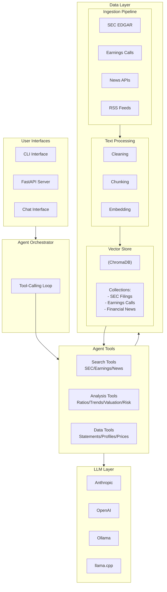

# AI Financial Analyst Agent

Enterprise RAG-powered financial analysis platform that combines SEC filings, earnings call transcripts, financial data APIs, and LLM-driven analysis to produce investment-research-grade insights.

## Architecture

### Mermaid Diagram



### System Overview (ASCII)

```
┌─────────────────────────────────────────────────────────────────────────────────┐
│                           AI Financial Analyst System                           │
├─────────────────────────────────────────────────────────────────────────────────┤
│                                                                                 │
│  ┌──────────────┐     ┌──────────────┐     ┌──────────────┐                     │
│  │   CLI        │     │   FastAPI    │     │   Chat       │                     │
│  │   Interface  │     │   Server     │     │   Interface  │                     │
│  └──────┬───────┘     └──────┬───────┘     └──────┬───────┘                     │
│         │                    │                    │                             │
│         └────────────────────┼────────────────────┘                             │
│                              │                                                  │
│                     ┌────────▼────────┐                                         │
│                     │   Agent         │                                         │
│                     │   Orchestrator  │                                         │
│                     │   (Tool Router) │                                         │
│                     └────────┬────────┘                                         │
│                              │                                                  │
│         ┌────────────────────┼────────────────────┐                             │
│         │                    │                    │                             │
│         ▼                    ▼                    ▼                             │
│  ┌──────────────┐    ┌──────────────┐    ┌──────────────┐                       │
│  │   RAG        │    │   Financial  │    │   Analysis   │                       │
│  │   Retriever  │    │   Data APIs  │    │   Engine     │                       │
│  └──────┬───────┘    └──────┬───────┘    └──────┬───────┘                       │
│         │                   │                   │                               │
└─────────┼───────────────────┼───────────────────┼───────────────────────────────┘
          │                   │                   │
          ▼                   ▼                   ▼
┌────────────────────────────────────────────────────────────────────────────────┐
│                              Data Layer                                        │
├────────────────────────────────────────────────────────────────────────────────┤
│                                                                                │
│  ┌───────────────────────────────────────────────────────────────────────────┐ │
│  │  Ingestion Pipeline                                                       │ │
│  │  ┌─────────────┐  ┌─────────────┐  ┌─────────────┐  ┌─────────────┐       │ │
│  │  │ SEC EDGAR   │  │ Earnings    │  │ Financial   │  │ RSS Feeds   │       │ │
│  │  │ Downloader  │  │ Calls       │  │ News APIs   │  │ (Fallback)  │       │ │
│  │  │             │  │ Processor   │  │ (Finnhub,   │  │             │       │ │
│  │  │ • 10-K      │  │             │  │  Alpha      │  │ • MarketWatch│      │ │
│  │  │ • 10-Q      │  │ • Transcripts│ │  Vantage)   │  │ • CNBC      │       │ │
│  │  │ • 8-K       │  │ • Speakers  │  │             │  │ • Business  │       │ │
│  │  │             │  │ • Q&A       │  │ • Headlines │  │   Insider   │       │ │
│  │  └──────┬──────┘  └──────┬──────┘  └──────┬──────┘  └──────┬──────┘       │ │
│  │         │                │                │                │              │ │
│  │         └────────────────┴────────────────┴────────────────┘              │ │
│  │                              │                                            │ │
│  │                     ┌────────▼────────┐                                   │ │
│  │                     │ Text Processing │                                   │ │
│  │                     │ • Cleaning      │                                   │ │
│  │                     │ • Chunking      │                                   │ │
│  │                     │ • Section Split │                                   │ │
│  │                     └────────┬────────┘                                   │ │
│  └──────────────────────────────┼────────────────────────────────────────────┘ │
│                                 │                                              │
│                                 ▼                                              │
│  ┌───────────────────────────────────────────────────────────────────────────┐ │
│  │  Embedding & Vector Store                                                 │ │
│  │  ┌─────────────────┐    ┌─────────────────────────────────────────────┐   │ │
│  │  │ Ollama /        │    │ ChromaDB Collections                        │   │ │
│  │  │ Sentence-       │───▶│ ┌─────────────┐ ┌─────────────┐ ┌─────────┐ │   │ │
│  │  │ Transformers    │    │ │ SEC Filings │ │ Earnings    │ │    News │ │   │ │
│  │  │ (768-dim)       │    │ │ (10-K,10-Q) │ │ Calls       │ │         │ │   │ │
│  │  └─────────────────┘    │ └─────────────┘ └─────────────┘ └─────────┘ │   │ │
│  │                         └─────────────────────────────────────────────┘   │ │
│  └───────────────────────────────────────────────────────────────────────────┘ │
│                                                                                │
│  ┌───────────────────────────────────────────────────────────────────────────┐ │
│  │  Local Storage (./data/)                                                  │ │
│  │  ├── sec_filings/     (JSON metadata for downloaded filings)              │ │
│  │  ├── news/            (Fetched news articles)                             │ │
│  │  ├── earnings_calls/  (Transcripts)                                       │ │
│  │  └── vector_store/    (ChromaDB persistent embeddings)                    │ │
│  └───────────────────────────────────────────────────────────────────────────┘ │
│                                                                                │
└────────────────────────────────────────────────────────────────────────────────┘
                                    │
                                    ▼
┌─────────────────────────────────────────────────────────────────────────────────┐
│                              LLM Layer                                          │
├─────────────────────────────────────────────────────────────────────────────────┤
│                                                                                 │
│  ┌───────────────────────────────────────────────────────────────────────────┐  │
│  │  Supported Providers (switch via LM_PROVIDER in .env)                     │  │
│  │  ┌──────────────┐  ┌──────────────┐  ┌──────────────┐  ┌──────────────┐   │  │
│  │  │ Anthropic    │  │ OpenAI       │  │ Ollama       │  │ llama.cpp    │   │  │
│  │  │ Claude       │  │ GPT-4        │  │ Local        │  │ GGUF Models  │   │  │
│  │  │ (Recommended)│  │              │  │ (Qwen3)      │  │              │   │  │
│  │  └──────────────┘  └──────────────┘  └──────────────┘  └──────────────┘   │  │
│  └───────────────────────────────────────────────────────────────────────────┘  │
│                                                                                 │
└─────────────────────────────────────────────────────────────────────────────────┘
                                        │
                                        ▼
┌─────────────────────────────────────────────────────────────────────────────────┐
│                              Output Layer                                       │
├─────────────────────────────────────────────────────────────────────────────────┤
│                                                                                 │
│  ┌─────────────────┐  ┌─────────────────┐  ┌─────────────────┐                  │
│  │ Structured      │  │ Citations &     │  │ Financial       │                  │
│  │ Reports         │  │ Sources         │  │ Ratios &        │                  │
│  │ (Markdown/JSON) │  │                 │  │ Metrics         │                  │
│  └─────────────────┘  └─────────────────┘  └─────────────────┘                  │
│                                                                                 │
└─────────────────────────────────────────────────────────────────────────────────┘
```

### Data Flow

```
┌─────────────┐     ┌─────────────┐     ┌─────────────┐     ┌─────────────┐
│   Ingest    │────▶│   Process   │────▶│   Embed     │────▶│   Store     │
│   (Fetch)   │     │   (Clean)   │     │   (Vector)  │     │   (ChromaDB)│
└─────────────┘     └─────────────┘     └─────────────┘     └─────────────┘
       │                   │                   │                   │
       ▼                   ▼                   ▼                   ▼
  SEC Filings         Remove HTML       Generate          Persist to
  News Articles       Split sections    768-dim           disk
  Earnings Calls      Chunk text        embeddings        ./data/vector_store/
```

### Query Flow

```
User Question ──▶ Agent Orchestrator ──▶ Tool Selection
                                              │
                    ┌─────────────────────────┼─────────────────────────┐
                    │                         │                         │
                    ▼                         ▼                         ▼
            ┌───────────────┐         ┌───────────────┐         ┌───────────────┐
            │ RAG Retrieval │         │ Financial     │         │ Analysis      │
            │ (Vector DB)   │         │ Data Fetch    │         │ Calculations  │
            └───────┬───────┘         └───────┬───────┘         └───────┬───────┘
                    │                         │                         │
                    └─────────────────────────┼─────────────────────────┘
                                              │
                                              ▼
                                      ┌───────────────┐
                                      │ LLM Synthesis │
                                      │ + Citations   │
                                      └───────┬───────┘
                                              │
                                              ▼
                                      ┌───────────────┐
                                      │ Final Answer  │
                                      └───────────────┘
```

## LLM Providers

Supports 4 LLM backends — switch via `LLM_PROVIDER` in `.env`:

| Provider | Config | Best For |
|----------|--------|----------|
| **Anthropic** | `LLM_PROVIDER=anthropic` | Highest quality analysis |
| **OpenAI** | `LLM_PROVIDER=openai` | Strong alternative |
| **Ollama** | `LLM_PROVIDER=ollama` | Local/private, no API costs |
| **llama.cpp** | `LLM_PROVIDER=llamacpp` | Direct GGUF model loading |

### Ollama Setup (Recommended for Local)

```bash
# Install & start Ollama
ollama serve

# Pull models
ollama pull qwen3:latest            # LLM
ollama pull nomic-embed-text-v2-moe # Embeddings
```

### llama.cpp Setup

```bash
# Option A: llama-server (HTTP API)
./llama-server -m model.gguf --port 8080

# Option B: Python bindings (in-process)
pip install llama-cpp-python
# Set LLAMACPP_MODEL_PATH=/path/to/model.gguf in .env
```

## Quick Start

```bash
# 1. Clone and install
cd ai_financial_analyst
pip install -r requirements.txt

# 2. Configure
cp .env.example .env
# Edit .env with your API keys and LLM provider choice

# 3. Ingest company data
python main.py ingest AAPL --forms 10-K 10-Q --count 3

# 4. Run analysis
python main.py analyze AAPL --type comprehensive

# 5. Interactive chat
python main.py chat

# 6. Start API server
python main.py serve
```

## API Endpoints

| Method | Endpoint | Description |
|--------|----------|-------------|
| POST | `/api/v1/query` | Ask any financial question (optional `ticker` focuses it) |
| POST | `/api/v1/query/stream` | Same, streamed as server-sent events (`sources`, `token`, `done`) |
| POST | `/api/v1/ingest` | Ingest SEC filings + news. Runs in the background and returns a job id (HTTP 202); set `run_in_background=false` to wait |
| GET | `/api/v1/jobs/{job_id}` | Status and result of a background ingestion job |
| POST | `/api/v1/ingest/earnings-call` | Ingest earnings transcript |
| POST | `/api/v1/analyze` | Run structured analysis |
| GET | `/api/v1/financials/{ticker}` | Get financial statements |
| GET | `/api/v1/profile/{ticker}` | Get company profile |
| GET | `/api/v1/ratios/{ticker}` | Calculate financial ratios |
| GET | `/api/v1/trends/{ticker}` | Multi-year growth, CAGR and margin trends (`include_ttm=true` adds trailing-twelve-month totals; needs a data API key) |
| POST | `/api/v1/conversation/reset` | Clear one conversation (`session_id` query param) |
| GET | `/api/v1/knowledge-base/stats` | Vector store statistics |
| GET | `/api/v1/config` | Current configuration |
| GET | `/health` | Health check |

### Security

- Set `API_KEY` in `.env` to require an `X-API-Key` header on every `/api/v1` endpoint (`/health` stays public). Without it the server logs a warning and is unauthenticated.
- Requests are rate limited per client (`RATE_LIMIT_PER_MINUTE`, default 60) and return `429` with `Retry-After` when exceeded.
- `/api/v1/query` keeps conversation history per `session_id` (returned in the response; send it back to continue). Sessions are namespaced per API key. Reset one with `POST /api/v1/conversation/reset?session_id=...`.
- Tickers, form types, analysis types and sizes are validated; provider keys are redacted from logs and error messages.
- Set `CORS_ORIGINS` to your real front-end origins in production.

### Example API Call

```bash
curl -X POST http://localhost:8000/api/v1/query \
  -H "Content-Type: application/json" \
  -d '{"query": "What are Apple risk factors from their latest 10-K?", "ticker": "AAPL"}'
```

## Financial Data Sources

- **SEC EDGAR**: 10-K, 10-Q, 8-K filings (free, rate-limited)
- **Financial Modeling Prep**: Statements, ratios, estimates (free tier available)
- **Alpha Vantage**: Prices, fundamentals, news (free tier)
- **Finnhub**: News, estimates, recommendations (free tier)
- **Polygon.io**: Market data (free tier)
- **RSS Feeds**: Financial news from MarketWatch, CNBC, Business Insider (free, no API key required)

### News Ingestion Priority

The system fetches news using the following priority:

1. **Finnhub API** (if `FINNHUB_API_KEY` is set)
2. **Alpha Vantage News** (if `ALPHA_VANTAGE_API_KEY` is set)
3. **RSS Feeds** (automatic fallback — no configuration needed)

RSS feeds search for company names (e.g., "Apple" for AAPL) in article titles and content. If company-specific news is unavailable, general market news is fetched as a fallback.

### Supported RSS Feeds

| Source | Feed Type |
|--------|-----------|
| MarketWatch | Top Stories |
| CNBC | Top News & Technology |
| Investing.com | Technology News |
| Business Insider | General Business |

### Company Name Mapping

The system automatically maps ticker symbols to company names for better RSS matching:

- **AAPL**: Apple, Apple Inc
- **MSFT**: Microsoft, Microsoft Corp
- **GOOGL/GOOG**: Google, Alphabet
- **AMZN**: Amazon, Amazon.com
- **TSLA**: Tesla, Tesla Inc
- **META**: Meta, Facebook
- **NVDA**: Nvidia, NVIDIA
- **JPM**: JPMorgan, J.P. Morgan
- **BAC**: Bank of America, BofA
- **WFC**: Wells Fargo
- **AMD**: AMD, Advanced Micro Devices
- **INTC**: Intel
- **NFLX**: Netflix
- **DIS**: Disney, Walt Disney
- **COIN**: Coinbase
- **PYPL**: PayPal
- **SQ**: Block, Square
- **UBER**: Uber
- **LYFT**: Lyft

To add more companies, edit the `COMPANY_NAMES` dictionary in `ingestion/financial_news.py`.

## Analysis Capabilities

- **Multi-period trends**: year-over-year growth, CAGR and margin changes (`analysis/trends.py`), included in every analysis prompt and in `/api/v1/trends/{ticker}`
- **Figure checking**: numbers in the narrative are compared with the statements, ratios, trends and retrieved sources; unmatched figures are returned as `verification` and listed in the report under "Figures To Double-Check" (the text is never altered)
- **Numbered citations**: retrieved passages are labelled `[S1]`, `[S2]`... and the response `sources` list uses the same ids, so claims can be traced
- **No data-API key needed for core statements**: without FMP/Alpha Vantage keys the client falls back to SEC XBRL company facts (annual income statement, balance sheet and cash flow). Quarterly statements, prices and analyst estimates still need an API key

- **Comprehensive Analysis**: Full investment research report
- **Earnings Analysis**: Quarter-over-quarter performance
- **Risk Analysis**: Operational, financial, regulatory, market risks
- **Valuation Analysis**: DCF framework, comparable multiples
- **30+ Financial Ratios**: Profitability, liquidity, leverage, efficiency, valuation, cash flow
- **Variance Analysis**: Budget vs. actual with driver decomposition

## Project Structure

```
ai_financial_analyst/
├── main.py                  # CLI entry point
├── config/
│   └── settings.py          # Pydantic settings (env vars)
├── core/
│   ├── llm_provider.py      # Anthropic/OpenAI/Ollama/llama.cpp
│   ├── embeddings.py        # Sentence-transformers/OpenAI/Ollama
│   ├── vector_store.py      # ChromaDB manager
│   └── text_processing.py   # Financial text chunking
├── ingestion/
│   ├── sec_edgar.py         # SEC EDGAR downloader/parser
│   ├── earnings_calls.py    # Earnings call processor
│   ├── financial_news.py    # Multi-source news aggregator
│   ├── sec_xbrl.py          # SEC XBRL facts -> statements
│   └── pipeline.py          # Unified ingestion orchestrator
├── rag/
│   └── retriever.py         # Multi-collection RAG retriever
├── analysis/
│   ├── financial_data.py    # Financial data API client
│   ├── ratios.py            # 30+ financial ratio calculator
│   ├── trends.py            # Multi-period growth and margin trends
│   └── financial_analyzer.py # LLM-powered analysis engine
├── agent/
│   ├── orchestrator.py      # Agent brain (tool routing)
│   └── tools.py             # Tool definitions for function calling
├── reports/
│   └── generator.py         # Markdown/JSON report generation
├── api/
│   └── server.py            # FastAPI endpoints
├── tests/
│   ├── test_ratios.py
│   └── test_text_processing.py
├── requirements.txt
├── Dockerfile
├── docker-compose.yml
└── .env.example
```

## Testing

```bash
pytest tests/ -v --cov=.
```

## Data Storage

Ingested data is stored locally in the `./data/` directory:

```
data/
├── sec_filings/           # Downloaded SEC filing metadata
│   ├── Apple_Inc__10-K_2025-10-31.json
│   ├── Apple_Inc__10-Q_2026-01-30.json
│   └── ...
├── news/                  # Fetched news articles
│   ├── news_AAPL_20260312_234023.json
│   └── ...
├── earnings_calls/        # Earnings call transcripts (if available)
└── vector_store/          # ChromaDB vector embeddings
    ├── sec_filings/
    ├── earnings_calls/
    └── financial_news/
```

### Vector Store Collections

The system maintains separate ChromaDB collections for different data types:

| Collection | Description |
|------------|-------------|
| `sec_filings` | SEC 10-K, 10-Q, 8-K filings |
| `earnings_calls` | Earnings call transcripts |
| `financial_news` | Financial news articles |

## Recent Updates

### Bug Fixes (March 2026)

1. **Regex Pattern Fix**: Fixed "global flags not at the start of the expression" error in SEC filing text processing by properly handling `(?i)` flags in combined regex patterns.

2. **ChromaDB Compatibility**: Fixed "'str' object is not callable" error by converting `ChromaEmbeddingFunction.name` from attribute to method for ChromaDB API compatibility.

### New Features (March 2026)

1. **RSS Feed News Ingestion**: Added automatic fallback to RSS feeds for financial news when API keys are not available. Supports MarketWatch, CNBC, Investing.com, and Business Insider.

2. **Company Name Matching**: Enhanced RSS news matching with company name mappings for 20+ major tech and finance companies (e.g., "Apple" for AAPL, "Microsoft" for MSFT).

## Docker

```bash
# With Ollama
docker-compose up -d

# Pull models inside the Ollama container
docker exec -it ollama ollama pull qwen3:latest
docker exec -it ollama ollama pull nomic-embed-text-v2-moe:latest
```

## Disclaimer

This tool is for **informational purposes only** and does not constitute investment advice. Always consult qualified financial professionals before making investment decisions.
